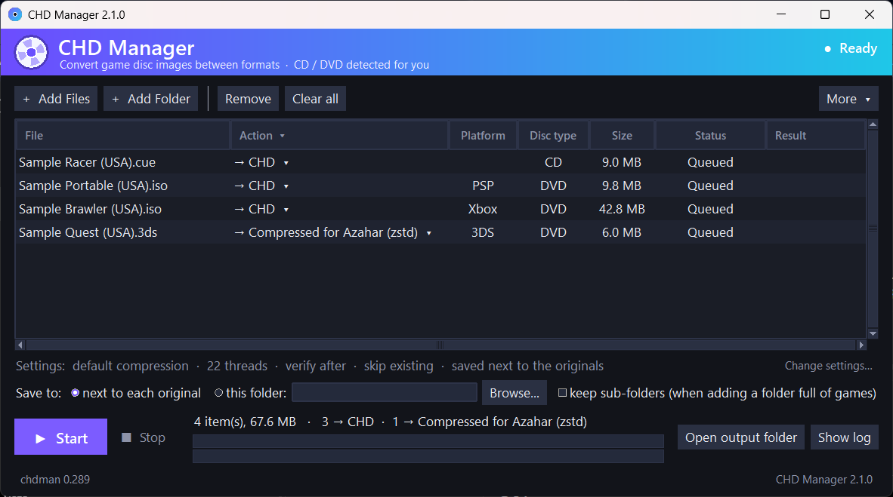
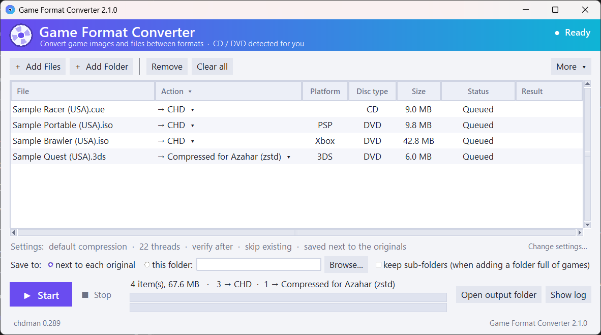
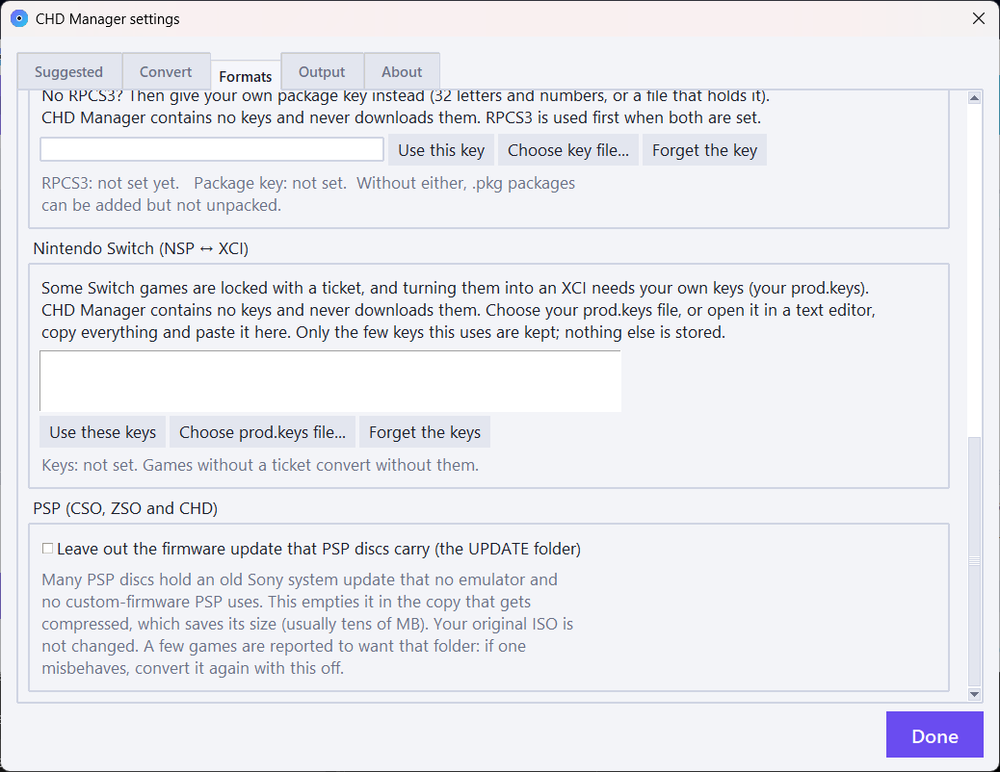
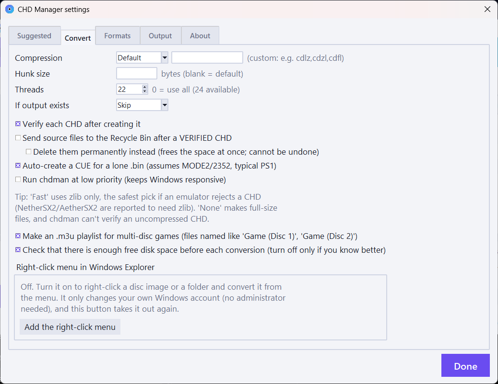
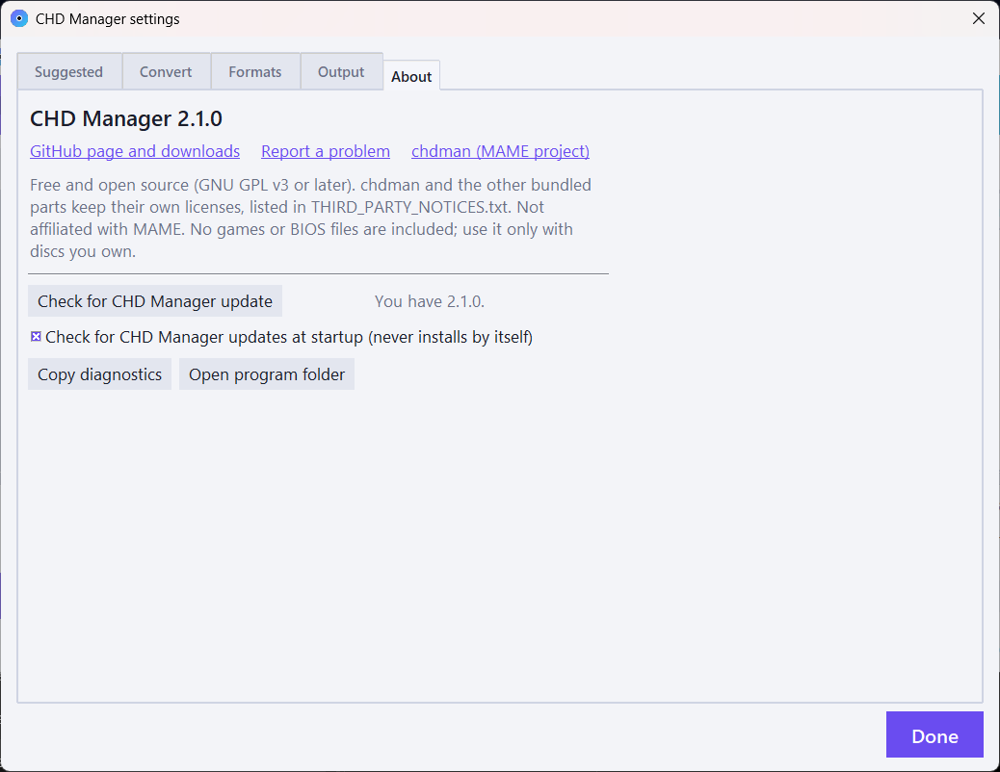

# Game Format Converter

**Formerly CHD Manager.** It was renamed in 2.1.0 because it now converts far more than CHDs. If you have an older CHD Manager, see [Coming from CHD Manager?](#coming-from-chd-manager).

A friendly app that converts game disc images and game files from one format to another, and the front end for MAME's `chdman`. Add your files, pick what each one should become, and press Start. It works out what each file is, only offers conversions that can work, checks there is room on the drive before it starts, and verifies what it wrote.

It covers **CHD, PBP, CDI, VCD, CSO/ZSO, ECM, ISO, CUE/BIN, GDI** (PlayStation, Dreamcast, Saturn, Sega CD, PSP), **RVZ, WIA, WBFS, GCZ, CISO, WUX/WUD** (GameCube, Wii, Wii U), **ZAR, ISO and game folders** (Xbox 360), **trimmed `.xiso.iso`** (original Xbox), **ISO, game folders and `.pkg`** (PlayStation 3), **NSP, XCI and NUP** (Nintendo Switch and Switch 2) and **`.zcci`, `.cia`, `.3ds`** (Nintendo 3DS).

It is portable: one folder, nothing installed. CHD conversions are done by `chdman` from the [MAME](https://github.com/mamedev/mame) project; every other format is handled by the program's own code.



<details>
<summary>Light theme and settings</summary>









</details>

## What's new in 2.1.0

- **A new name:** CHD Manager is now Game Format Converter.
- **Xbox 360:** ZAR (for Xenia), ISO and game folders, in every direction that makes sense. Xbox 360 download packages (the hex-named single files, such as Xbox Live Arcade and Games on Demand) are not discs, so they are refused with a plain explanation.
- **Original Xbox:** a full 7.8 GB dump becomes a trimmed `.xiso.iso` that holds just the game; also game folders and CHD.
- **PlayStation 3:** game folder to ISO and back, multiMAN split pieces joined, and `.pkg` packages unpacked and packed (with RPCS3 or with your own key; see [Keys](#keys-and-what-the-program-does-not-contain)).
- **Nintendo Switch:** NSP to XCI and back, a bundle of base game + newest update + DLC into one file, one NSP per title, swapping in a newer update, and a firmware safeguard that tells you when your keys are older than the game. **NUP (Switch and Switch 2, experimental):** a decrypted game folder to NUP and back, and an NSP or XCI to NUP (the game, its newest update merged into the game's files, and its DLC, unpacked with your own keys).
- **Nintendo 3DS:** compress `.3ds`/`.cci`/`.cxi`/`.3dsx` for the Azahar emulator and unpack them again; make a CIA from a decrypted `.3ds`; make a `.3ds` from a decrypted CIA. Nothing is ever decrypted.
- **PSP:** CSO version 2 (real PSP only), plus an option that leaves out the useless firmware update (the `UPDATE` folder) when compressing.
- **PlayStation 2 VCD** (POPStarter), **M3U playlists** for multi-disc games, **Linux** support, a **right-click menu** in Windows and Linux file managers, a **log file** and a one-click **support report**, and plain-English windows that say why a file was refused.

## What it converts

Each file in the list has an **Action** drop-down; it only offers what can work for that file.

| Format | What it is | Read | Write |
| --- | --- | :-: | :-: |
| **CHD** | MAME's compressed disc format (CD, DVD and Dreamcast GD-ROM) | yes | yes |
| **CUE/BIN, GDI, ISO** | Plain disc images | yes | yes |
| **PBP** | PlayStation 1 games for the PSP and Vita (multi-disc too), with optional artwork or a drawn title card | yes | yes |
| **CDI** | DiscJuggler images (including Dreamcast CD-Rs) | yes | yes |
| **VCD** | PS1 games for POPStarter on the PS2 | yes | yes |
| **MDS/MDF, NRG, CCD/IMG** | Alcohol 120%, Nero and CloneCD images | yes | no |
| **CSO, ZSO** | Compressed PSP/PS2 ISOs (CSO uses deflate, ZSO uses LZ4; version 2 CSO is read, and written as an opt-in for real PSPs) | yes | yes |
| **ECM** | Neill Corlett's format that removes error-correction data from raw CD images | yes | yes |
| **RVZ, WIA, WBFS, GCZ, CISO** | Dolphin's and the Wii backup managers' GameCube and Wii formats | yes | yes |
| **WUX, WUD** | Wii U disc images (compressed and raw) | yes | yes |
| **Xbox 360: ZAR, ISO, game folder** | ZAR is the file archive Xenia uses for a disc's files | yes | yes |
| **Original Xbox: `.xiso.iso`, game folder** | A full dump trimmed to just the game, or its loose files | yes | yes |
| **PS3: ISO, game folder, split pieces** | Folder to ISO and back; `.iso.0`/`.66600` pieces are joined | yes | yes |
| **PS3: `.pkg`** | Unpacked to a game folder; a game folder packed into a package | yes | yes |
| **Switch: NSP, XCI** | Package to cartridge image and back; one NSP per title; bundles with the newest update and DLC | yes | yes |
| **Switch / Switch 2: NUP** | Game folder (base, updates, DLC) to NUP and back; an NSP or XCI to NUP (the base game, the newest update merged into it, and DLC; needs your `prod.keys`; files that are the same in the game and its update are stored once). Experimental | yes | yes |
| **3DS: `.zcci`, `.zcxi`, `.z3dsx`** | Azahar's compressed 3DS files | yes | yes |
| **3DS: `.3ds`/`.cci`, `.cia`** | Cartridge dump to CIA, and CIA back to a `.3ds`, for decrypted games | yes | yes |
| **ZIP, TAR, GZ, 7Z, RAR** | Archives are opened as input (7Z and RAR use 7-Zip) | yes | n/a |

Also: **rebuild a CD's error correction**, **extract the artwork from a PBP**, and **title cards** that give a PBP a readable name in the PSP menu.

## Features

- **Drag and drop** files or folders onto the window or the exe, or use Add Files / Add Folder. Folders are searched recursively.
- **One Action choice per file.** Click the cell to change it, or the *Action* heading to set it for every file that can do it.
- **Detected automatically:** CD or DVD for CHD, and the platform (PS1, PS2, PSP, Dreamcast, Saturn, Sega CD, GameCube, Wii, Wii U, Xbox, Xbox 360, PS3, Switch, 3DS). Right-click to force CD or DVD.
- **Any format to any format it can produce.** Where there is no direct route the program goes through a temporary, uncompressed CHD.
- **Plain refusals.** A file that can't be converted is not silently skipped: a window lists each one and says why (damaged, encrypted, not a disc, the wrong kind of package, a missing piece).
- **Safety.** Optional verify after each conversion (read the result back and compare it with the source). Optional "send sources to the Recycle Bin", only after a verified result; the program won't overwrite the file it is converting from, and two items with the same output name are numbered instead of overwriting each other.
- **Disk-space check** before each job, which can be switched off.
- **Buttons are locked while the program is working**, so a click can't disturb a running conversion.
- **Save to:** next to each original, or one folder of your choice, chosen on the main window.
- **Suggested settings** fill in thread count and compression; they never overwrite a choice you made yourself.
- **File names** from the game's title, ID or region, using PlayStation game data, PARAM.SFO, or the name stored on a GameCube/Wii disc.
- **Command line** (`chdm`): the same conversions without a window. See [Command line](#command-line).
- **Updates.** The two version buttons at the bottom of the window (chdman on the left, the program on the right) are also the update buttons. Updates are checksum-verified, test-run, and never installed without you confirming.
- **Log file and support report.** The program writes `chd_manager.log` next to its settings file (it keeps about 1 MB and rolls over once). *More, Copy a report for support* copies the version, system details and the recent log with your user name hidden. **The log contains the names of the files you converted**, so look before you post it.

## Download and use

### Windows

1. Get `Game-Format-Converter-<version>-win64.zip` from the [Releases](../../releases) page and unzip it anywhere.
2. Run **Game Format Converter.exe**.
3. Click **Add Files** or **Add Folder** (or drag them in), check the Action column, and press **Start**.

Windows 10/11, 64-bit. Python is not needed. Settings are saved in `chd_manager_settings.json` next to the exe.

**About warnings:** the exe is not code-signed, so Windows SmartScreen may say "unknown publisher" (choose *More info, then Run anyway*) and some antivirus programs are suspicious of this kind of packaged Python program. If you would rather not run a binary, [run it from source](#run-from-source) or [build it yourself](#build-the-exe).

**Right-click menu (optional):** *Settings, Output, Add the right-click menu* adds "Convert with Game Format Converter", "Convert with Game Format Converter to" and "Add to Game Format Converter" for your user only, and *Remove the right-click menu* takes them out again. On Windows 11 they appear under *Show more options*.

### Linux (experimental)

Download `Game-Format-Converter-<version>-source.zip`, unzip it, and run `./chd-manager.sh`. It needs `python3` with tkinter and a `chdman` (for example the `mame-tools` package); if something is missing the launcher says what, why, and the exact command, and asks before running anything. Optional: `tkdnd` for drag and drop, `python3-zstandard` for RVZ, ZSO, ZAR, NUP and the 3DS compressed formats. The Windows-only parts are replaced or switched off (your desktop's trash instead of the Recycle Bin, no chdman updater). Settings, the log and the right-click menu (a KDE Dolphin service menu, GNOME Files scripts and an "Open with" entry, all inside your own `~/.local/share`) work on Linux; see *More, What to install (and why)* in the app.

I could only test Linux on Ubuntu 24.04 under WSL2. It has **not** been tried on a Steam Deck, on macOS, or in a real Dolphin or Nautilus window. Treat it as experimental and please report what you find.

## Coming from CHD Manager?

This is the same program under a new name and a new repository address. An older CHD Manager (2.0.x) can't find this release by itself, so download it once from the [Releases](../../releases) page and unzip it anywhere; you can then delete the old folder. Your settings don't carry over: for the optional features that need them (Wii, PlayStation 3 and Switch keys, the base PBP, the artwork folder and so on), put them in again under *Settings*.

## Keys, and what the program does not contain

The program contains **no keys, no firmware, no BIOS files, no games and no decryption keys of any kind**, and never downloads one. Where a format needs one, you supply your own:

- **Wii discs to RVZ/WIA/WBFS:** your own copy of Dolphin (the program runs its `DolphinTool.exe`) or your own Wii key (a text file in the `keys` folder, or pasted in the setup window).
- **PlayStation 3 packages (`.pkg`):** point *Settings, Formats, PlayStation 3* at your own `rpcs3.exe`, or paste your own package key.
- **Switch packages that carry a ticket:** your own `prod.keys` (choose the file or paste it). Games without a ticket, and XCI to NSP, need no keys.
- **Nintendo 3DS:** nothing is decrypted. A `.3ds` or CIA must already be decrypted, and the program refuses encrypted ones and says so. Nothing from Nintendo, including certificates, is embedded in the files it builds.

The program stores the keys you give it in `chd_manager_settings.json` next to it, so **don't share that file**. It is never part of the release zip.

## Command line

The `chdm.cmd` launcher in the Windows zip runs the same conversions without a window and passes on the exit code (0 = everything done or skipped, 1 = something failed, 2 = wrong command line):

```
chdm game.cue --to chd -o D:\chd
chdm game.chd --to pbp --level 9 -o D:\psp
chdm D:\roms --to chd --exists overwrite --log convert.txt
chdm game.chd game2.iso --list
chdm --help
```

`--list` shows what each file can become. In `cmd`, run it as `.\chdm` (or put the folder on your PATH). On Linux use `./chd-manager.sh cli ...`. Options for the new formats (`--rpcs3`, `--pkg-key`, `--switch-keys`, `--ps3-split`, `--ps3-update`, `--no-m3u`, `--no-space-check`) are listed by `--help`.

## How CD vs DVD is chosen for CHD

| Image | Type |
| --- | --- |
| `.cue`, `.gdi`, `.toc`, loose `.bin` | CD (`createcd`) |
| `.pbp` (PlayStation 1), `.cdi`, `.vcd`, `.mds`/`.mdf`, `.nrg`, `.ccd`/`.img` | CD: unpacked to `.cue`/`.bin` in a temporary folder first, then `createcd` |
| `.iso` up to 737,280,000 bytes (an 80-minute CD) | CD |
| `.iso` larger than that, and PSP, Xbox, Xbox 360 and PS3 images | DVD (`createdvd`) |

If a PS2 game on a CD slightly exceeds the size limit, or anything else is detected wrongly, right-click it and force the type. Check that one game boots before converting a collection.

## Network use

The program is offline except for the update checks, each with its own on/off switch (chdman on the *Output* page of the settings window, the program on its *About* page):

- At startup it asks GitHub for the latest MAME release number and the latest Game Format Converter release. It never downloads anything by itself.
- When you confirm a Game Format Converter update it downloads the release from this repo, verifies its SHA-256, test-runs the new version, and only then replaces itself (keeping a copy of the old one to roll back to). When you confirm a chdman update it downloads the official release from `github.com/mamedev/mame`.
- Two optional downloads, each only on request and checked against a fixed checksum: the base PBP files for a real PSP (from [iPoPS](https://github.com/julianxhokaxhiu/iPoPS)) and a refreshed game list.

## Run from source

Needs Python 3 with tkinter (tested with 3.12), `chdman` next to the script (`chdman.exe` from a [MAME release](https://github.com/mamedev/mame/releases) on Windows), and `pip install zstandard` for RVZ, ZSO, ZAR, NUP and the 3DS compressed formats:

```
python CHD_Manager.pyw
```

## Build the exe

Needs Python 3 (tested with 3.12) and 7-Zip.

```
powershell -ExecutionPolicy Bypass -File build.ps1
```

This installs PyInstaller and zstandard, downloads the latest official chdman and the game list (checking the SHA-256 of both), builds `Game Format Converter.exe`, and writes the portable folder, the Windows zip and the source zip to `dist/`. Use `-ChdmanPath` to supply your own chdman.

## Testing

Everything below was run on Windows 11 with chdman 0.289 unless it says otherwise. The program's own code is driven by automated test scripts; the sample discs and games are my own backups. "Played" means I started the game in that emulator and it ran; I did not play any game through.

**Played or booted in a real emulator or on real hardware**

| What | Where | Result |
| --- | --- | --- |
| CHD, PBP, CDI, PS1/PS2/Dreamcast conversions (2.0 work, 42 real discs) | PCSX2, DuckStation, RetroArch/Flycast, a real PSP | Booted; data checksums match the originals |
| CSO version 2, written by this program | A real PSP | Plays. **PPSSPP refuses version 2** ("CSO version too high"), which is why it is opt-in and version 1 stays the default |
| Xbox 360 ISO and ZAR made from a real game | Xenia Canary: both play. Xenia (main): ISO only | Worked |
| Original Xbox: a full dump trimmed to `.xiso.iso` | xemu | Crazy Taxi 3 (7.83 GB dump to 395 MB) boots |
| PS3 game folder to ISO | RPCS3 | Boots (Mayhem sometimes stalls at a loading screen, including with the ISO of the reference tool, so that looks like an RPCS3 or game quirk) |
| PS3 ISO to folder | RPCS3 | Plays |
| Switch NSP with a ticket to XCI; XCI to NSP (a base game with an update and seven DLC); the same game split into nine NSPs and joined into an XCI again | An emulator | Worked: the update and all seven DLC were active in the game that had them |
| Switch 2 folder to NUP (base + update, a 6.5 GB game) | Eglantine, a Switch 2 emulator build | Loaded and played |
| Switch NSP with a ticket to NUP (four base games, the largest 7.2 GB with 4,678 files) | None: read back and checked only | Unpacked with prod.keys, every file read back against its checksum; the files look right (a GBA ROM header and the exefs `NSO0` mark) |
| Switch NSP + its update NSP (+ DLC) to NUP (three games: updates of 25 MB, 160 MB and 454 MB; one with two DLC) | None: checked against the hashes stored in the files | The update's patch is merged into the game's files and the result matches every checksum stored in the update; the game's and the DLC's files match theirs; the NUP reads back; an update for the wrong game is refused |
| 3DS: `.zcci` made by this program | Azahar | Boots and runs |
| 3DS: `.cia` made from a decrypted dump | Azahar | Installs and runs (title screen reached) |
| 3DS: `.3ds` made from that CIA | Azahar | Boots |

**Checked against reference tools or real files (not played)**

- GameCube and Wii: 6 sample RVZ files and one WBFS converted to ISO and compared with Dolphin's own `DolphinTool`: byte-identical. Our RVZ, WIA, GCZ and CISO were opened by DolphinTool and gave the same disc. A 4.7 GB Wii disc to RVZ took about 19 s.
- Xbox 360 folder to ISO: the same size as `extract-xiso`'s and identical when unpacked; the ZAR unpacks to the original with the official `zarchive` tool.
- PS3 packages: unpacked results are identical to RPCS3's own on three real games (including seven updates for one game); a package this program packed was installed by RPCS3 and gave back the original folder, with one file differing (an install-order marker in extra content).
- 3DS: files made by Azahar (a `.zcci` and a `.zcxi`) are read and unpacked correctly; the metadata note this program adds to compressed files matches Azahar's byte for byte on those two files; a CIA made from a decrypted dump matches the layout of a real one.
- Mode 1 error correction rebuilt on 43,997 real Sega CD sectors: 0 differences.

**Not tested**

- **A real 3DS.** The CIA it makes is **unsigned and has no certificate chain**. Azahar accepts it; installation and launch on a 3DS running custom firmware have not been verified, and a console on stock firmware will refuse it.
- **A real Switch, Switch 2 or PS3.** Packed XCI, NUP and PKG files are for emulators, not for real consoles (Sony and Nintendo signatures can't be made).
- **The PSP "leave out the firmware update" option in PPSSPP or on a PSP.** It was only checked on a made-up image (the original is never changed; the update's files are emptied in a temporary copy). A few PSP games are reported to read that folder, which is why it is off by default.
- **Switch:** swapping in a newer update was only checked on made-up files; the individual split NSPs were not loaded in an emulator on their own; "newest update only" follows how the patch files work but is not documented authoritatively. The firmware table is from a public wiki.
- **VCD** files were only checked by converting back and forth; I could not try one on a PS2 with POPStarter.
- **Locked buttons** (a click during a conversion can't disturb it) were checked in the program's own code and tests, not by clicking.
- **NUP** follows a draft specification. A Switch 2 NUP has worked in one emulator; a NUP made from a Switch NSP or XCI has not been loaded in any emulator (an XCI source was not tried either, only NSPs). Other loaders may differ.
- **PS3:** packed packages were installed by RPCS3, but I did not launch a game from one; multiMAN pieces larger than 4 GB were only tried with made-up pieces.
- **Xbox:** only Crazy Taxi 3 was tried in xemu; a rebuilt Xbox 360 ISO has no security data and is for emulators only. Xbox 360 ISO to ZAR works, but Xenia main does not read ZAR.
- **Linux:** only Ubuntu 24.04 under WSL2. Not a Steam Deck, not macOS, not a real Dolphin or Nautilus right-click menu, and not the Linux self-update against a real release.
- **Windows right-click menu:** the entries are registered and launch the program (checked through Windows' own verb mechanism), but I could not click the cascading "Convert with Game Format Converter to" submenu.
- Any file made by other programs for some formats (CISO, GCZ, WIA with purge compression, split WBFS, ECM from other tools), multi-track `.nrg`, multi-session images, PBPs on a PSP Go, Vita or PS Classic, and playing any game all the way through.

## Credits and license

- `chdman` is from the [MAME](https://github.com/mamedev/mame) project and its authors. This program is not made by, affiliated with, or endorsed by MAME. "MAME" is a registered trademark of Gregory Ember.
- The GameCube and Wii disc code is a Python port of parts of the [Dolphin](https://github.com/dolphin-emu/dolphin) emulator's DiscIO code (GPL-2.0-or-later), and is the reason this project is GPL. Not affiliated with Dolphin.
- The other formats were written from public format descriptions and by reading open-source projects, without copying their code: [ZArchive](https://github.com/Exzap/ZArchive) (Xbox 360 ZAR) and `extract-xiso` (Xbox images); [RPCS3](https://github.com/RPCS3/rpcs3) (PS3 packages) and Estwald's `makeps3iso` (PS3 ISOs); [NSC Builder](https://github.com/julesontheroad/NSC_BUILDER) and [NSP-Box](https://github.com/smarkyie/NSP-Box) (Switch), and the [NUP specification](https://github.com/a55uka/nup); [Azahar](https://github.com/azahar-emu/azahar) (its Z3DS compressed format; its code is GPL-3 and none of it is copied) and [3dsconv](https://github.com/ihaveamac/3dsconv) (the CIA layout, which was used as a cross-check); `maxcso` (CSO version 2); and the format notes at 3dbrew.
- The ECM format and reference tools are by Neill Corlett; ZSO uses the LZ4 block format by Yann Collet; PBP and CDI layouts were worked out with help from [PSXPackager](https://github.com/RupertAvery/PSXPackager) (MIT, RupertAvery), whose `gameInfo.db` game list ships in the Windows zip. The Wii U formats follow the public format descriptions (the [Cemu](https://github.com/cemu-project/Cemu) source was consulted as a reference).
- The optional base PBP files for real-PSP use are downloaded on request from [iPoPS](https://github.com/julianxhokaxhiu/iPoPS) (MIT); they are not part of this project.
- Built with help from Claude (Anthropic); designed and tested by Mr-Shizzy.
- Unofficial: this project is not affiliated with Sony, Microsoft, Nintendo, Sega or any emulator named above. It includes no games, BIOS files, firmware, keys or other copyrighted game content. Use it only with games you own.

Game Format Converter is free software under the [GNU General Public License, version 3 or (at your option) any later version](LICENSE). The Windows release also bundles chdman, Python, Tcl/Tk and zstandard, whose licenses are in [THIRD_PARTY_NOTICES.txt](THIRD_PARTY_NOTICES.txt).
