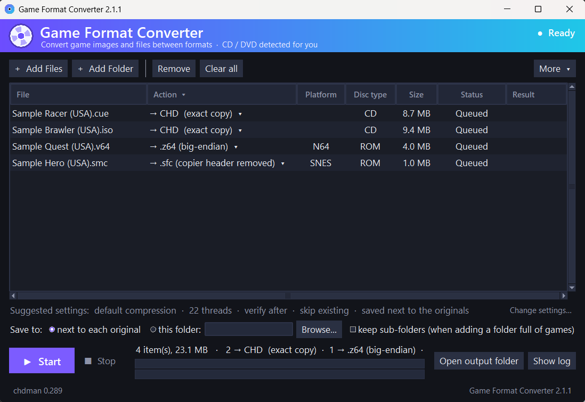
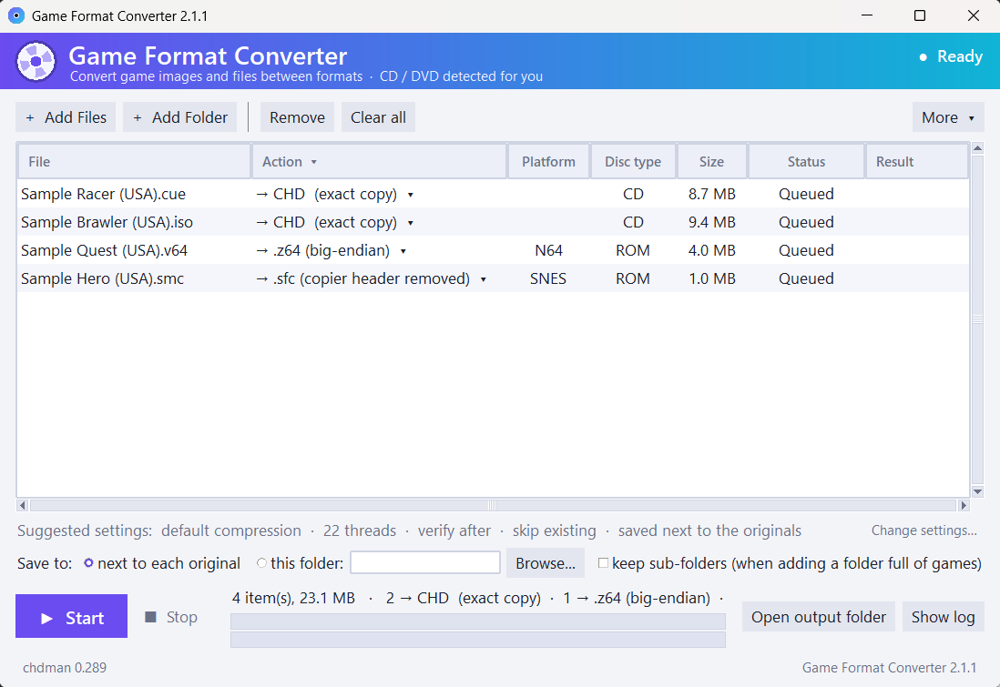
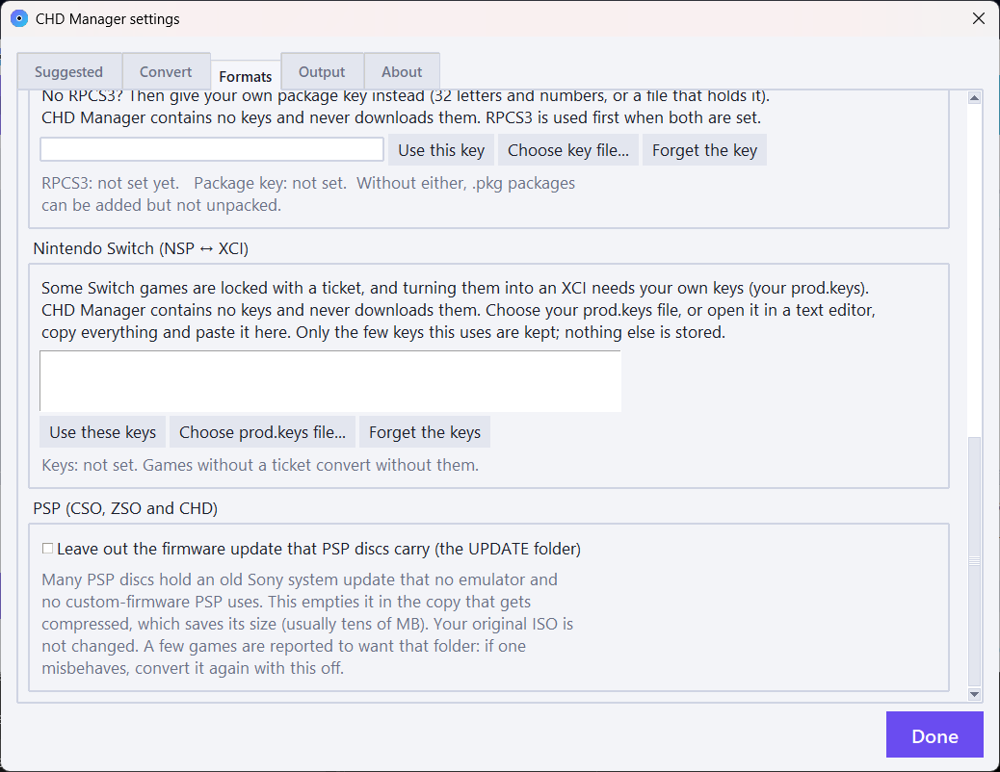
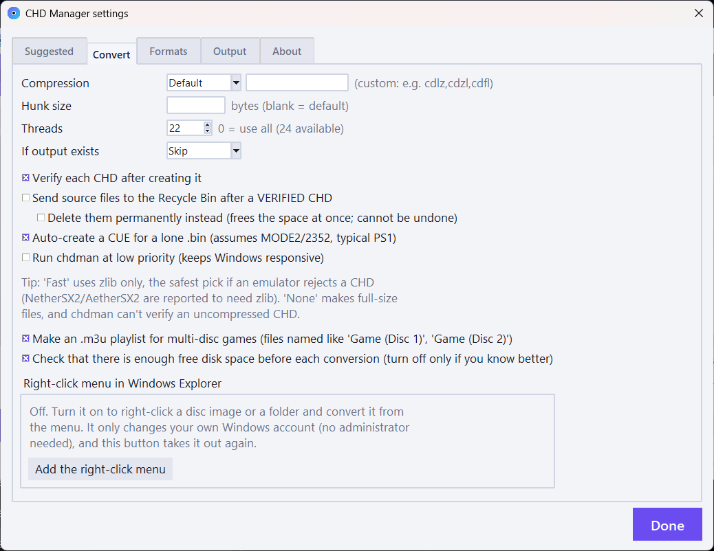
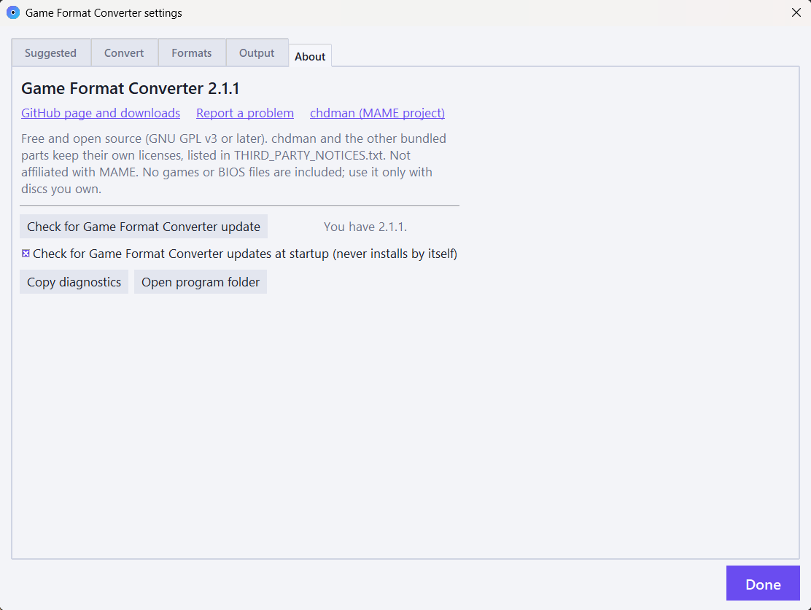

# Game Format Converter

**Formerly CHD Manager.** It was renamed in 2.1.0 because it now converts far more than CHDs. If you have an older CHD Manager, see [Coming from CHD Manager?](#coming-from-chd-manager).

A friendly app that converts game disc images and game files from one format to another, and the front end for MAME's `chdman`. Add your files, pick what each one should become, and press Start. It works out what each file is, only offers conversions that can work, checks there is room on the drive before it starts, and verifies what it wrote.

It covers **CHD, PBP, CDI, VCD, CSO/ZSO, ECM, ISO, CUE/BIN, GDI** (PlayStation, Dreamcast, Saturn, Sega CD, PSP), **RVZ, WIA, WBFS, GCZ, CISO, WUX/WUD** (GameCube, Wii, Wii U), **ZAR, ISO and game folders** (Xbox 360), **trimmed `.xiso.iso`** (original Xbox), **ISO, game folders and `.pkg`** (PlayStation 3), **NSP, XCI and NUP** (Nintendo Switch and Switch 2), **`.zcci`, `.cia`, `.3ds`** (Nintendo 3DS), **`.z64`, `.v64`, `.n64`** (Nintendo 64 byte orders), **SNES, Mega Drive, PC Engine and Nintendo DS ROM tools** (copier headers, shuffled layouts, trimming, checks) and **Games on Demand packages** (Xbox 360, to ISO).

It is portable: one folder, nothing installed. CHD conversions are done by `chdman` from the [MAME](https://github.com/mamedev/mame) project; every other format is handled by the program's own code.



<details>
<summary>Light theme and settings</summary>









</details>

## What's new in 2.1.1

- **Nintendo 64:** switch a ROM between `.z64` (big-endian, what most emulators and recompilation projects want), `.v64` (byte-swapped) and `.n64` (little-endian). The program reads the byte order from the ROM's first bytes, not from its name, so a mislabeled file is handled correctly. Nothing is added or removed, only reordered, so converting back gives the original bytes.
- **Nintendo 64 ROM check:** a *Check ROM* action works out the ROM's two header checksums and tells you whether they match, which is a quick way to spot a damaged or modified ROM. It also runs after a conversion when verification is on. The row shows the ROM's title, game code and region, and the name pattern in the settings (`%TITLE%`, `%GAMEID%`, `%REGION%`) can use them, so a file called `rom (3).v64` can become `NAME - Army Men Sarge (USA).z64`.
- **Super Nintendo:** take the 512-byte copier header off a `.smc` (giving a `.sfc`) or put a plain one on. The ROM's own header is read first to be sure the file really is a SNES ROM (LoROM, HiROM or ExHiROM), and a *Check SNES ROM* action works out its checksum. The game's own bytes are never touched; only the 512 extra bytes come or go.
- **Nintendo DS (and DSi-enhanced):** cut the empty padding off a full-size ROM (*trim*), or pad a trimmed one back to the cartridge's full size with `0xFF` (*untrim*), and a *Check DS ROM* action that reads the header. The header says where the game ends; for a DSi-enhanced game the DSi section comes after the DS part, so the program trims after the DSi section, never at the DS size where older tools would cut the DSi half off. The 136 bytes some games carry after their end (a DS game's Download Play certificate, which starts with `ac`) are kept. For a DSi game the header's own "total size" field is only used as a cross-check, because it was empty or wrong on 3 of the 5 DSi games tried; if the header contradicts itself the game is not trimmed. Nothing is cut unless everything after the end is padding (`0x00` or `0xFF` bytes): a game that keeps real data there is left alone. Original files are never changed; a new file named `(trimmed)` or `(full size)` is written beside them.
- **PC Engine / TurboGrafx-16:** take the 512-byte copier header off a HuCard ROM (or put a plain one on). Because a PC Engine ROM has no title or checksum to read, the file is recognised by its size (a whole number of 8 KB banks, with or without the header) and by the start-up vectors every ROM keeps at the end of its first bank; the *Check PC Engine ROM* action only reports the structure. A new file keeps the `.pce` extension and gets `(no header)` or `(with header)` added to its name so it never replaces the original. Bit-swapped US TurboGrafx-16 dumps are refused, not converted.
- **Mega Drive / Genesis:** turn a shuffled `.smd` (the Super Magic Drive copier's format) into a normal ROM, or a normal ROM into a `.smd`, and check the ROM's own checksum. Only the layout and the 512-byte header change; the game's bytes are the same. A `.smd` holds whole 16 KB blocks, so a ROM whose size isn't a whole number of blocks (or is over 4 MB) can't be made into one without adding bytes, and the program doesn't offer it.
- **Safe defaults for the ROM tools:** a ROM that is already in the form most tools want (a `.z64`, a SNES or PC Engine ROM without a copier header, a normal Mega Drive ROM) is only checked when you press Start. Pick the other action in the drop-down if you do want a converted copy.
- **Safeguards for the new ROM tools:** a conversion never writes over a file that is itself in the list (even with *If output exists* set to Overwrite; the new file gets a different name instead); a file is recognised by its contents, not its name; random or damaged files are refused and left alone; and the Action label stops saying *exact copy* when the PSP option that leaves out the firmware update folder is on.
- **Right-click menu:** a menu installed by an earlier version is refreshed once so it also offers the new file types, on Windows and Linux (on Linux this also adds the 3DS, Switch and CIA types, which the 2.1.0 menu was missing). The N64, SNES and Mega Drive entries only appear on those file types. Names that other programs also use (`.md`, `.gen`, `.fig`, `.swc`) are never given a menu entry, and are only picked up when their contents are a ROM. The Linux menu was checked by generating its files and having Ubuntu's own `update-mime-database` accept them; it has not been tried in a real Dolphin or GNOME Files window. Thunar (Xfce), Nemo (Linux Mint) and Caja (MATE) are covered too: Thunar gets a "Game Format Converter" submenu with the same conversions as Windows (it only shows on the file types that conversion fits, and the program adds it to Thunar's own actions file as one marked block, leaving every other byte of that file, your own actions and comments included, exactly as it was; removing the menu takes the block out again and gives the file back as it was); Nemo and Caja, which cannot do submenus, get "Convert" and "Add" and you pick the format in the window. File names are matched in lower or upper case (`.iso` and `.ISO`), not in mixed case.
- **Xbox 360 Games on Demand:** a game kept as a Games on Demand package (a small header file with a long hex name, next to a `<name>.data` folder of `Data0000`, `Data0001` ...) can become an ISO that Xenia loads like any other. Add the header file, or drop the whole folder you keep your Xbox 360 content in: the program finds the packages, ignores the `.data` files and anything that isn't a game disc (Arcade games, updates, caches), and names the ISO after the game. Every block is checked against the hashes stored in the package while it is read, so a damaged or half-copied package is refused instead of turned into a broken ISO, and the finished image's folders are read to make sure every file is inside it. **Nothing is decrypted:** the game's files are exactly as they were on the disc. The package leaves out the parts of a disc that aren't the game's files (the video partition, the security sector and the empty space before the file table), so the ISO has zeros there: it works in an emulator, but it is not a dump identical to the disc and not for a real console. Going the other way (making a package from an ISO) is not offered, because a package this program built couldn't carry Microsoft's signature.
- **Linux:** the right-click menus above, the self-update (a source install checks the release, verifies its checksum, test-runs the new version and keeps the old files in `previous-version`), drag and drop, and PlayStation 3 `.pkg` unpacking with your own key now work there as well. The program also finds `chdman` and Dolphin's tool the Linux way, and no longer mistakes a Windows `chdman.exe` for one it can run. Linux is still experimental; see [Linux](#linux-experimental) for what was and wasn't tried.
- **ROMs are no longer called discs:** the *Disc type* column now says *ROM* for a Nintendo 64, SNES, Mega Drive, PC Engine or DS ROM, instead of a guessed *DVD*.
- **Is it an exact copy?** The Action drop-down now says what each result is: *exact copy*, *trimmed*, *repacked* or *files only*. See [Is the result an exact copy?](#is-the-result-an-exact-copy).

## What's new in 2.1.0

- **A new name:** CHD Manager is now Game Format Converter.
- **Xbox 360:** ZAR (for Xenia), ISO and game folders, in every direction that makes sense. Xbox 360 download packages (the hex-named single files, such as Xbox Live Arcade games, title updates and DLC) are not discs, so they are refused with a plain explanation. A Games on Demand game (a header file with a `.data` folder beside it) is the exception: it is turned into an ISO.
- **Original Xbox:** a full 7.8 GB dump becomes a trimmed `.xiso.iso` that holds just the game; also game folders and CHD.
- **PlayStation 3:** game folder to ISO and back, multiMAN split pieces joined, and `.pkg` packages unpacked and packed (with RPCS3 or with your own key; see [Keys](#keys-and-what-the-program-does-not-contain)).
- **Nintendo Switch:** NSP to XCI and back, a bundle of base game + newest update + DLC into one file, one NSP per title, swapping in a newer update, and a firmware safeguard that tells you when your keys are older than the game. **Switch 2:** folder to NUP and back (experimental).
- **Nintendo 3DS:** compress `.3ds`/`.cci`/`.cxi`/`.3dsx` for the Azahar emulator and unpack them again; make a CIA from a decrypted `.3ds`; make a `.3ds` from a decrypted CIA. Nothing is ever decrypted.
- **PSP:** CSO version 2 (real PSP only), plus an option that leaves out the useless firmware update (the `UPDATE` folder) when compressing.
- **PlayStation 2 VCD** (POPStarter), **M3U playlists** for multi-disc games, **Linux** support, a **right-click menu** in Windows and Linux file managers, a **log file** and a one-click **support report**, and plain-English windows that say why a file was refused.

## What it converts

Each file in the list has an **Action** drop-down; it only offers what can work for that file.

| Format | What it is | Read | Write |
| --- | --- | :-: | :-: |
| **CHD** | MAME's compressed disc format (CD, DVD and Dreamcast GD-ROM) | yes | yes |
| **CUE/BIN, GDI, ISO** | Plain disc images | yes | yes |
| **PBP** | PlayStation 1 games for the PSP and Vita (multi-disc too), with optional artwork or a drawn title card | yes | yes |
| **CDI** | DiscJuggler images (including Dreamcast CD-Rs) | yes | yes |
| **VCD** | PS1 games for POPStarter on the PS2 | yes | yes |
| **MDS/MDF, NRG, CCD/IMG** | Alcohol 120%, Nero and CloneCD images | yes | no |
| **CSO, ZSO** | Compressed PSP/PS2 ISOs (CSO uses deflate, ZSO uses LZ4; version 2 CSO is read, and written as an opt-in for real PSPs) | yes | yes |
| **ECM** | Neill Corlett's format that removes error-correction data from raw CD images | yes | yes |
| **RVZ, WIA, WBFS, GCZ, CISO** | Dolphin's and the Wii backup managers' GameCube and Wii formats | yes | yes |
| **WUX, WUD** | Wii U disc images (compressed and raw) | yes | yes |
| **Xbox 360: ZAR, ISO, game folder** | ZAR is the file archive Xenia uses for a disc's files | yes | yes |
| **Xbox 360: Games on Demand package** | A game kept as a header file plus a `.data` folder, turned into an ISO (every block checked against the package's hashes) | yes | no |
| **Original Xbox: `.xiso.iso`, game folder** | A full dump trimmed to just the game, or its loose files | yes | yes |
| **PS3: ISO, game folder, split pieces** | Folder to ISO and back; `.iso.0`/`.66600` pieces are joined | yes | yes |
| **PS3: `.pkg`** | Unpacked to a game folder; a game folder packed into a package | yes | yes |
| **Switch: NSP, XCI** | Package to cartridge image and back; one NSP per title; bundles with the newest update and DLC | yes | yes |
| **Switch 2: NUP** | Game folder (base, updates, DLC) to NUP and back; compressed (zstd) or uncompressed, which stores every file as it is so a program can read any part of a file straight from the NUP. Experimental | yes | yes |
| **3DS: `.zcci`, `.zcxi`, `.z3dsx`** | Azahar's compressed 3DS files | yes | yes |
| **3DS: `.3ds`/`.cci`, `.cia`** | Cartridge dump to CIA, and CIA back to a `.3ds`, for decrypted games | yes | yes |
| **N64: `.z64`, `.v64`, `.n64`** | The same ROM in its three byte orders; only reordered, nothing else changes. Also a check of the ROM's header checksums | yes | yes |
| **SNES: `.smc`, `.sfc`** | The 512-byte copier header taken off or put on; also a checksum check | yes | yes |
| **Nintendo DS: `.nds`, `.dsi`** | Trimmed or full size (padding cut off or put back); DSi-enhanced games handled with their DSi section; also a header check | yes | yes |
| **PC Engine / TurboGrafx-16: `.pce`, `.tg16`** | The 512-byte copier header taken off or put on | yes | yes |
| **Mega Drive / Genesis: `.md`/`.bin`/`.gen`, `.smd`** | Shuffled `.smd` to a normal ROM and back; also a checksum check | yes | yes |
| **ZIP, TAR, GZ, 7Z, RAR** | Archives are opened as input (7Z and RAR use 7-Zip); the program does not create archives | yes | n/a |

Also: **rebuild a CD's error correction**, **extract the artwork from a PBP**, and **title cards** that give a PBP a readable name in the PSP menu.

## Is the result an exact copy?

Some conversions keep everything and some leave things out on purpose. The Action drop-down says which, in brackets after the name. If you are archiving something you can't replace, look at this first.

| The drop-down says | What it means | Conversions |
| --- | --- | --- |
| **exact copy** | Everything in the original is kept. Convert back and you get the same data. | CHD, Recompress, CSO, ZSO, ECM, RVZ, WIA, GCZ, CISO, and Azahar's compressed 3DS files (`.zcci`, `.zcxi`, `.z3dsx`) |
| **trimmed** or **trimmed by default** | Parts of the original are left out and can't be put back. | WBFS (unused parts of the disc are left out; turn off *WBFS: leave out data nothing uses (scrub)* in the settings to keep them). The original Xbox `.xiso.iso` also says so in its name: a full dump is cut down to just the game |
| **repacked** | The game's files are kept, but they are put into a new container, so it is not the same file a dump would be, and Nintendo's and Sony's signatures can't be made. | 3DS CIA and `.3ds` made from each other; Switch NSP to XCI, XCI to NSP, and one NSP per title; PS3 `.pkg`; NUP; an Xbox 360 Games on Demand package made into an ISO |
| **files only** | The disc's files without the disc around them. | Xbox 360 ZAR. A rebuilt Xbox 360 ISO has no security data |
| *(nothing)* | The answer depends on what you started from, for example ISO or game folder. | ISO, CUE/BIN, game folder, PBP, CDI, VCD |

An exact copy means exact **as far as the disc data goes**: for example, a CD's CHD holds the sectors you gave it. A few options also change the content on purpose and say so where you switch them on, such as the PSP option that leaves out the firmware `UPDATE` folder (off by default). For anything with no label, or that you can't replace, keep the original until you have checked the result.

How it was checked: CHD, CSO and ZSO were taken from ISO and back to ISO on made-up images, and the results were identical to the originals. RVZ, WIA, GCZ and CISO were checked against Dolphin's own tool (see the testing section). The N64 byte-order changes were checked against an independent implementation on made-up ROMs and tried on four real backups: converting to the other orders and back gave the original bytes, and the converted `.z64` files' header checksums (CRC1 and CRC2) matched the ones the program recomputed from the ROM, which only happens when every byte is in the right place. The program also reads every converted ROM back to compare it with the original when verification is on.

## Features

- **Drag and drop** files or folders onto the window or the exe, or use Add Files / Add Folder. Folders are searched recursively.
- **One Action choice per file.** Click the cell to change it, or the *Action* heading to set it for every file that can do it.
- **Detected automatically:** CD or DVD for CHD, and the platform (PS1, PS2, PSP, Dreamcast, Saturn, Sega CD, GameCube, Wii, Wii U, Xbox, Xbox 360, PS3, Switch, 3DS). Right-click to force CD or DVD.
- **Any format to any format it can produce.** Where there is no direct route the program goes through a temporary, uncompressed CHD.
- **Plain refusals.** A file that can't be converted is not silently skipped: a window lists each one and says why (damaged, encrypted, not a disc, the wrong kind of package, a missing piece).
- **Safety.** Optional verify after each conversion (read the result back and compare it with the source). Optional "send sources to the Recycle Bin", only after a verified result; the program won't overwrite the file it is converting from, and two items with the same output name are numbered instead of overwriting each other.
- **Disk-space check** before each job, which can be switched off.
- **Buttons are locked while the program is working**, so a click can't disturb a running conversion.
- **Save to:** next to each original, or one folder of your choice, chosen on the main window.
- **Suggested settings** fill in thread count and compression; they never overwrite a choice you made yourself.
- **File names** from the game's title, ID or region, using PlayStation game data, PARAM.SFO, the name stored on a GameCube/Wii disc, or the title, game code and region in a Nintendo 64 ROM's header (the ROM's own title is at most 20 characters, so it is often shortened).
- **Command line** (`chdm`): the same conversions without a window. See [Command line](#command-line).
- **Updates.** The two version buttons at the bottom of the window (chdman on the left, the program on the right) are also the update buttons. Updates are checksum-verified, test-run, and never installed without you confirming.
- **Log file and support report.** The program writes `chd_manager.log` next to its settings file (it keeps about 1 MB and rolls over once). *More, Copy a report for support* copies the version, system details and the recent log with your user name hidden. **The log contains the names of the files you converted**, so look before you post it.

## Download and use

### Windows

1. Get `Game-Format-Converter-<version>-win64.zip` from the [Releases](../../releases) page and unzip it anywhere.
2. Run **Game Format Converter.exe**.
3. Click **Add Files** or **Add Folder** (or drag them in), check the Action column, and press **Start**.

Windows 10/11, 64-bit. Python is not needed. Settings are saved in `chd_manager_settings.json` next to the exe.

**About warnings:** the exe is not code-signed, so Windows SmartScreen may say "unknown publisher" (choose *More info, then Run anyway*) and some antivirus programs are suspicious of this kind of packaged Python program. If you would rather not run a binary, [run it from source](#run-from-source) or [build it yourself](#build-the-exe).

**Right-click menu (optional):** *Settings, Output, Add the right-click menu* adds "Convert with Game Format Converter", "Convert with Game Format Converter to" and "Add to Game Format Converter" for your user only, and *Remove the right-click menu* takes them out again. On Windows 11 they appear under *Show more options*.

### Linux (experimental)

Download `Game-Format-Converter-<version>-source.zip`, unzip it, and run `./chd-manager.sh`. It needs `python3` with tkinter and a `chdman` (for example the `mame-tools` package); if something is missing the launcher says what, why, and the exact command, and asks before running anything. Optional: `tkdnd` for drag and drop, `python3-zstandard` for RVZ, ZSO, ZAR, NUP and the 3DS compressed formats. The Windows-only parts are replaced or switched off (your desktop's trash instead of the Recycle Bin, no chdman updater). Settings, the log and the right-click menu (a KDE Dolphin service menu, GNOME Files scripts and an "Open with" entry, all inside your own `~/.local/share`) work on Linux; see *More, What to install (and why)* in the app.

I could only test Linux on Ubuntu 24.04 under WSL2. It has **not** been tried on a Steam Deck, on macOS, or in a real Dolphin, GNOME Files or Thunar right-click menu. Treat it as experimental and please report what you find.

## Coming from CHD Manager?

This is the same program under a new name and a new repository address. An older CHD Manager (2.0.x) can't find this release by itself, so download it once from the [Releases](../../releases) page and unzip it anywhere; you can then delete the old folder. Your settings don't carry over: for the optional features that need them (Wii, PlayStation 3 and Switch keys, the base PBP, the artwork folder and so on), put them in again under *Settings*.

## Keys, and what the program does not contain

The program contains **no keys, no firmware, no BIOS files, no games and no decryption keys of any kind**, and never downloads one. Where a format needs one, you supply your own:

- **Wii discs to RVZ/WIA/WBFS:** your own copy of Dolphin (the program runs its `DolphinTool.exe`) or your own Wii key (a text file in the `keys` folder, or pasted in the setup window).
- **PlayStation 3 packages (`.pkg`):** point *Settings, Formats, PlayStation 3* at your own `rpcs3.exe`, or paste your own package key.
- **Switch packages that carry a ticket:** your own `prod.keys` (choose the file or paste it). Games without a ticket, and XCI to NSP, need no keys.
- **Nintendo 3DS:** nothing is decrypted. A `.3ds` or CIA must already be decrypted, and the program refuses encrypted ones and says so. Nothing from Nintendo, including certificates, is embedded in the files it builds.

The program stores the keys you give it in `chd_manager_settings.json` next to it, so **don't share that file**. It is never part of the release zip.

## Command line

The `chdm.cmd` launcher in the Windows zip runs the same conversions without a window and passes on the exit code (0 = everything done or skipped, 1 = something failed, 2 = wrong command line):

```
chdm game.cue --to chd -o D:\chd
chdm game.chd --to pbp --level 9 -o D:\psp
chdm D:\roms --to chd --exists overwrite --log convert.txt
chdm game.chd game2.iso --list
chdm --help
```

`--list` shows what each file can become. In `cmd`, run it as `.\chdm` (or put the folder on your PATH). On Linux use `./chd-manager.sh cli ...`. Options for the new formats (`--rpcs3`, `--pkg-key`, `--switch-keys`, `--ps3-split`, `--ps3-update`, `--no-m3u`, `--no-space-check`) are listed by `--help`.

## How CD vs DVD is chosen for CHD

| Image | Type |
| --- | --- |
| `.cue`, `.gdi`, `.toc`, loose `.bin` | CD (`createcd`) |
| `.pbp` (PlayStation 1), `.cdi`, `.vcd`, `.mds`/`.mdf`, `.nrg`, `.ccd`/`.img` | CD: unpacked to `.cue`/`.bin` in a temporary folder first, then `createcd` |
| `.iso` up to 737,280,000 bytes (an 80-minute CD) | CD |
| `.iso` larger than that, and PSP, Xbox, Xbox 360 and PS3 images | DVD (`createdvd`) |

If a PS2 game on a CD slightly exceeds the size limit, or anything else is detected wrongly, right-click it and force the type. Check that one game boots before converting a collection.

## Network use

The program is offline except for the update checks, each with its own on/off switch (chdman on the *Output* page of the settings window, the program on its *About* page):

- At startup it asks GitHub for the latest MAME release number and the latest Game Format Converter release. It never downloads anything by itself.
- When you confirm a Game Format Converter update it downloads the release from this repo, verifies its SHA-256, test-runs the new version, and only then replaces itself (keeping a copy of the old one to roll back to). When you confirm a chdman update it downloads the official release from `github.com/mamedev/mame`.
- Two optional downloads, each only on request and checked against a fixed checksum: the base PBP files for a real PSP (from [iPoPS](https://github.com/julianxhokaxhiu/iPoPS)) and a refreshed game list.

## Run from source

Needs Python 3 with tkinter (tested with 3.12), `chdman` next to the script (`chdman.exe` from a [MAME release](https://github.com/mamedev/mame/releases) on Windows), and `pip install zstandard` for RVZ, ZSO, ZAR, NUP and the 3DS compressed formats:

```
python CHD_Manager.pyw
```

## Build the exe

Needs Python 3 (tested with 3.12) and 7-Zip.

```
powershell -ExecutionPolicy Bypass -File build.ps1
```

This installs PyInstaller and zstandard, downloads the latest official chdman and the game list (checking the SHA-256 of both), builds `Game Format Converter.exe`, and writes the portable folder, the Windows zip and the source zip to `dist/`. Use `-ChdmanPath` to supply your own chdman.

## Testing

Everything below was run on Windows 11 with chdman 0.289 unless it says otherwise. The program's own code is driven by automated test scripts; the sample discs and games are my own backups. "Played" means I started the game in that emulator and it ran; I did not play any game through.

**Played or booted in a real emulator or on real hardware**

| What | Where | Result |
| --- | --- | --- |
| CHD, PBP, CDI, PS1/PS2/Dreamcast conversions (2.0 work, 42 real discs) | PCSX2, DuckStation, RetroArch/Flycast, a real PSP | Booted; data checksums match the originals |
| CSO version 2, written by this program | A real PSP | Plays. **PPSSPP refuses version 2** ("CSO version too high"), which is why it is opt-in and version 1 stays the default |
| Xbox 360 ISO and ZAR made from a real game | Xenia Canary: both play. Xenia (main): ISO only | Worked |
| Original Xbox: a full dump trimmed to `.xiso.iso` | xemu | Crazy Taxi 3 (7.83 GB dump to 395 MB) boots |
| PS3 game folder to ISO | RPCS3 | Boots (Mayhem sometimes stalls at a loading screen, including with the ISO of the reference tool, so that looks like an RPCS3 or game quirk) |
| PS3 ISO to folder | RPCS3 | Plays |
| Switch NSP with a ticket to XCI; XCI to NSP (a base game with an update and seven DLC); the same game split into nine NSPs and joined into an XCI again | An emulator | Worked: the update and all seven DLC were active in the game that had them |
| Switch 2 folder to NUP (base + update, a 6.5 GB game) | Eglantine, a Switch 2 emulator build | Loaded and played |
| N64: `.n64`-named files that are really in `.v64` order, converted to `.z64` (Army Men: Sarge's Heroes, Turok: Rage Wars) | Rosalie's Mupen GUI 0.9.1 | Both play |
| N64: a fan English translation (AI Shougi 3) and a ROM hack (Crash Bandicoot 64), each converted from `.z64` to `.v64` and to `.n64` | Rosalie's Mupen GUI 0.9.1 | All four converted files play |
| SNES: a ROM hack with its copier header removed, and two games with a header added (ActRaiser, Aladdin) | Snes9x 1.60 | All three run (the emulator showed a quick bad-checksum notice on one, as expected for a hack that wasn't re-signed, and ran it anyway) |
| Mega Drive: three normal ROMs converted to `.smd` (3 Ninjas Kick Back, Splatterhouse 3, Zabu), and Zabu converted back to a normal ROM | Gens 2.14 | All load and start (title or intro screens) |
| DS: two full-size games trimmed (Mario Hoops 3 on 3, Bomberman) and one padded to full size (Billiard Action) | melonDS 0.9.5 | All three run (title screens, menus and in-game) |
| PC Engine: four real ROMs with a copier header added by this program (Bonk's Adventure, Andre Panza Kick Boxing, Sonic Spike, Legend of Hero Tonma) | RetroArch with the Mednafen PCE Fast core | All run |
| Xbox 360: a Games on Demand package (Dead Rising 2, 39 data files, 6.6 GB) made into an ISO by this program | Xenia Canary | Boots to the title screen, the main menu and the opening cutscene; not played further |
| 3DS: `.zcci` made by this program | Azahar | Boots and runs |
| 3DS: `.cia` made from a decrypted dump | Azahar | Installs and runs (title screen reached) |
| 3DS: `.3ds` made from that CIA | Azahar | Boots |

**Checked against reference tools or real files (not played)**

- GameCube and Wii: 6 sample RVZ files and one WBFS converted to ISO and compared with Dolphin's own `DolphinTool`: byte-identical. Our RVZ, WIA, GCZ and CISO were opened by DolphinTool and gave the same disc. A 4.7 GB Wii disc to RVZ took about 19 s.
- Xbox 360 folder to ISO: the same size as `extract-xiso`'s and identical when unpacked; the ZAR unpacks to the original with the official `zarchive` tool.
- Xbox 360 Games on Demand: on the real package, all 1.6 million blocks matched their stored hashes (the header's hash for the first table, each data file's link to the next, every table, every block); the ISO made from it lists 666 files with every one inside the image, and reading the package and the ISO against each other gave no difference. Made-up packages with a damaged block, hash table, master table, a missing or cut-short data file, no `.data` folder or an impossible layout were each refused with a plain sentence; the same checks pass under Linux (Ubuntu 24.04 on WSL2). Converting the real package under Linux (WSL2) gave an ISO with the same SHA-256 as the one made on Windows.
- PS3 packages: unpacked results are identical to RPCS3's own on three real games (including seven updates for one game); a package this program packed was installed by RPCS3 and gave back the original folder, with one file differing (an install-order marker in extra content).
- 3DS: files made by Azahar (a `.zcci` and a `.zcxi`) are read and unpacked correctly; the metadata note this program adds to compressed files matches Azahar's byte for byte on those two files; a CIA made from a decrypted dump matches the layout of a real one.
- Mode 1 error correction rebuilt on 43,997 real Sega CD sectors: 0 differences.

**Not tested**

- **A real 3DS.** The CIA it makes is **unsigned and has no certificate chain**. Azahar accepts it; installation and launch on a 3DS running custom firmware have not been verified, and a console on stock firmware will refuse it.
- **A real Switch, Switch 2 or PS3.** Packed XCI, NUP and PKG files are for emulators, not for real consoles (Sony and Nintendo signatures can't be made).
- **The PSP "leave out the firmware update" option in PPSSPP or on a PSP.** It was only checked on a made-up image (the original is never changed; the update's files are emptied in a temporary copy). A few PSP games are reported to read that folder, which is why it is off by default.
- **Switch:** swapping in a newer update was only checked on made-up files; the individual split NSPs were not loaded in an emulator on their own; "newest update only" follows how the patch files work but is not documented authoritatively. The firmware table is from a public wiki.
- **Nintendo 64:** the byte-order change was tried on six real ROMs (two ordinary `.z64` backups, two named `.n64` that are really in `.v64` order, a fan English translation and a ROM hack) and checked as described above, and the two `.z64` files made from the `.v64`-order ones, plus `.v64` and `.n64` versions of the translation and the hack, were played in Rosalie's Mupen GUI 0.9.1. No recompilation project was tried with the results. The *Check ROM* checksums matched on all six real ROMs tried: five use the most common boot chip type (6102) and one (a ROM hack) uses 6105; the other two types (6103 and 6106) are written from the published method but have not been tried on a real ROM. The header checksums only cover the first megabyte after the boot code, so a match is a good sign, not proof that the whole ROM is perfect. The three orders are told apart by the ROM header's first bytes; an unusual build that doesn't start the usual way is refused rather than guessed.
- **Super Nintendo:** tried on 11 real ROMs. Header checksums matched on 10 (the 11th, a ROM hack, doesn't match, which is normal for one that wasn't re-signed), and adding or removing the header gave back the original bytes every time. Only one of the 11 had a copier header, so the header-removal path was exercised on a single real ROM. A ROM whose size isn't a power of two can't be checked with certainty, so a checksum difference there is reported as unsure, not as a problem.
- **Mega Drive / Genesis:** tried on six real ROMs (all in the normal layout; no real `.smd` was available, so reading a `.smd` from a real copier was only tested on `.smd` files this program made, checked against a separate implementation of the layout). Converting each to `.smd` and back gave the original bytes, and the header checksum matched on five of the six (the console doesn't check it, and some retail ROMs, hacks and homebrew carry a wrong one). Three `.smd` files made by this program, and one converted back, were loaded in Gens 2.14.
- **Nintendo DS:** tried on 101 real ROMs (96 DS, 5 DSi-enhanced): all were recognised and the rule for where each game ends gave the right answer for every one (91 were already trimmed, including 10 that carry the 136-byte signature and all 5 DSi games, and 10 were full size). The 10 full-size ROMs were trimmed (including one whose padding is a mix of `0x00` and `0xFF`), and padding then trimming a ROM gave back the original bytes on five real ROMs including two DSi games. **No DSi-enhanced game was seen running:** in melonDS 0.9.5 (as set up here) three of them (Alice in Wonderland, Cars 2, De Blob 2) show a blank screen from the original file as well, identically to the padded copy, so the emulator test proved nothing for those. I also compared the trimming rule with two open-source trimmers by reading their code and applying their rules to the same 101 ROMs (their programs were not run): ndstrim gives the same size as this program on all 96 DS games but, by its code, would cut one of the DSi games to 0 bytes and another to about 145 KB because it trusts that one header field; the older NDS-Rom-Trimmer (cut after the last non-`0xFF` byte) disagrees on 10, cutting into a game's own last bytes on 8 and leaving 30 MB and 5 MB of zero padding on two. A few games are reported to read data past the end of a trimmed ROM; the program refuses to cut anything that isn't padding, but keep your originals.
- **PC Engine / TurboGrafx-16:** tried on 104 real ROMs (zipped No-Intro-style dumps, all without a copier header), so the header-removal path itself was only exercised on files this program had put a header on: adding a header to six real ROMs and taking it off again gave back the original bytes every time. There is no checksum in these ROMs to confirm a real one, so a conversion is checked by reading the new file back against the original. Recognising a ROM uses the start-up vectors and the first instruction of its reset code, which was tuned on those 104 ROMs; an unusual ROM may be refused.
- **Xbox 360 Games on Demand:** tried on one real package, whose header says "installed game" (content type `0x4000`) rather than plain Games on Demand (`0x7000`); the two are read the same way, but a `0x7000` package was not available to try. The layout where the disc is stored from its first sector instead of from the file table was only tried on a package I made up. A package whose hash tables don't match is refused, not repaired. The ISO was played in Xenia Canary only as far as the title screen, the main menu and the opening cutscene (a few minutes), not played through, and not tried in other emulators. Games that keep data in the part of the disc before the file table can't be rebuilt from a package (the package doesn't have it); the program reads the result's folders and refuses an image if a file lies past its end, but it can't tell what an original disc held there.
- **VCD** files were only checked by converting back and forth; I could not try one on a PS2 with POPStarter.
- **Locked buttons** (a click during a conversion can't disturb it) were checked in the program's own code and tests, not by clicking.
- **Switch 2 NUP** follows a draft specification and has worked in one emulator; other loaders may differ.
- **PS3:** packed packages were installed by RPCS3, but I did not launch a game from one; multiMAN pieces larger than 4 GB were only tried with made-up pieces.
- **Xbox:** only Crazy Taxi 3 was tried in xemu; a rebuilt Xbox 360 ISO has no security data and is for emulators only. Xbox 360 ISO to ZAR works, but Xenia main does not read ZAR.
- **Linux:** only Ubuntu 24.04 under WSL2. Not a Steam Deck, not macOS, and not a real Dolphin, GNOME Files or Thunar right-click menu. The Linux self-update was run against the real release, from a throwaway copy with its version number set back: it checked GitHub, downloaded the source zip, matched its SHA-256, test-ran the new version, installed it with a backup of the old files and left settings and keys alone; a tampered download, a wrong address, a duplicate file name, a half-finished write and a read-only folder were each refused or undone in offline tests. What else was tried there: every format test, a clean unzip run through `chd-manager.sh` (ISO to CHD and back, identical), the window starting and converting, and installing and removing the right-click menu files in a scratch folder (read back, and built into a real file-type database). The Dolphin menu offers each kind of file the same conversions as the Windows menu (one menu file per kind, checked against Ubuntu's list of file types and with freedesktop's own `desktop-file-validate`), but how it looks in a real Dolphin, and whether those menu files show up as one submenu there, has not been seen. The GNOME Files and Caja menus (a Scripts menu) and Nemo's are only "Convert" and "Add" (that is all they can do; pick the format in the window). Thunar's and Nemo's choose by file name, so they do appear on `.bin` and `.m3u` files like the Windows menu; Dolphin's does not, because Linux has no game type for them (and they hold firmware and music playlists too). The Thunar, Nemo and Caja files were checked against each program's own documentation and source and tested in scratch folders (including adding to an actions file that has other, translated actions, comments, Windows line endings or a BOM and getting it back byte for byte after removing, installing twice, a file Thunar re-saved, a symlinked file, and an actions file that can't be read, which is left untouched); Nemo and Caja were then run for real (under WSL, with a stand-in program that only records what it is started with): Nemo listed all four actions as enabled, showed Convert and Add on an ISO (also `.ISO` in capitals) and the folder versions on a folder, showed nothing on a text file, and handed the program the file's full path; Caja's Scripts menu showed both scripts and handed the program every selected name (including a folder and names with spaces and parentheses). Thunar read the file and listed the actions in its own custom-actions window with the right file patterns and kinds of file, but its right-click menu could not be clicked in that test, so which entries it shows for which file is only checked by simulating its name matching. Converting a PlayStation 3 `.pkg` to a game folder through your own RPCS3 is Windows-only; on Linux it needs your own package key (the program's AES step was checked on Linux against the standard published AES test vector, with and without Python's `cryptography` package, and one whole retail package from the PlayStation Network, 270 MB and ten files, was unpacked with the tester's own key on both Windows and Linux with byte-identical results; the game's files then read back as a PSN game folder with the right title). Wii RVZ/WIA through Dolphin's own tool: the program looks for `dolphin-tool` in the usual Linux places and "Find Dolphin" accepts it, but it was never run against a real Dolphin on Linux, and a Flatpak or AppImage Dolphin can't be used this way (give your own Wii key instead). Drag and drop on Linux needs the optional `tkdnd` package: with tkdnd 2.6 the window registers as a drop target, and drops were delivered the way tkdnd delivers them (names with spaces, several files, folders, braces in a name) and added correctly, but a real mouse drag could not be tried under WSL.
- **Windows right-click menu:** the entries are registered and launch the program (checked through Windows' own verb mechanism), but I could not click the cascading "Convert with Game Format Converter to" submenu.
- Any file made by other programs for some formats (CISO, GCZ, WIA with purge compression, split WBFS, ECM from other tools), multi-track `.nrg`, multi-session images, PBPs on a PSP Go, Vita or PS Classic, and playing any game all the way through.

## Credits and license

- `chdman` is from the [MAME](https://github.com/mamedev/mame) project and its authors. This program is not made by, affiliated with, or endorsed by MAME. "MAME" is a registered trademark of Gregory Ember.
- The GameCube and Wii disc code is a Python port of parts of the [Dolphin](https://github.com/dolphin-emu/dolphin) emulator's DiscIO code (GPL-2.0-or-later), and is the reason this project is GPL. Not affiliated with Dolphin.
- The other formats were written from public format descriptions and by reading open-source projects, without copying their code: [ZArchive](https://github.com/Exzap/ZArchive) (Xbox 360 ZAR) and `extract-xiso` (Xbox images); the [Free60](https://free60.org) notes on the Xbox 360 package format (Games on Demand); [RPCS3](https://github.com/RPCS3/rpcs3) (PS3 packages) and Estwald's `makeps3iso` (PS3 ISOs); [NSC Builder](https://github.com/julesontheroad/NSC_BUILDER) and [NSP-Box](https://github.com/smarkyie/NSP-Box) (Switch), and the [NUP specification](https://github.com/a55uka/nup); [Azahar](https://github.com/azahar-emu/azahar) (its Z3DS compressed format; its code is GPL-3 and none of it is copied) and [3dsconv](https://github.com/ihaveamac/3dsconv) (the CIA layout, which was used as a cross-check); `maxcso` (CSO version 2); and the format notes at 3dbrew.
- The ECM format and reference tools are by Neill Corlett; ZSO uses the LZ4 block format by Yann Collet; PBP and CDI layouts were worked out with help from [PSXPackager](https://github.com/RupertAvery/PSXPackager) (MIT, RupertAvery), whose `gameInfo.db` game list ships in the Windows zip. The Wii U formats follow the public format descriptions (the [Cemu](https://github.com/cemu-project/Cemu) source was consulted as a reference).
- The optional base PBP files for real-PSP use are downloaded on request from [iPoPS](https://github.com/julianxhokaxhiu/iPoPS) (MIT); they are not part of this project.
- Built with help from Claude (Anthropic); designed and tested by Mr-Shizzy.
- Unofficial: this project is not affiliated with Sony, Microsoft, Nintendo, Sega or any emulator named above. It includes no games, BIOS files, firmware, keys or other copyrighted game content. Use it only with games you own.

Game Format Converter is free software under the [GNU General Public License, version 3 or (at your option) any later version](LICENSE). The Windows release also bundles chdman, Python, Tcl/Tk and zstandard, whose licenses are in [THIRD_PARTY_NOTICES.txt](THIRD_PARTY_NOTICES.txt).
